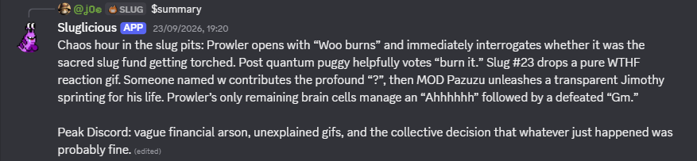
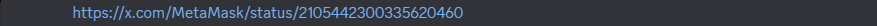
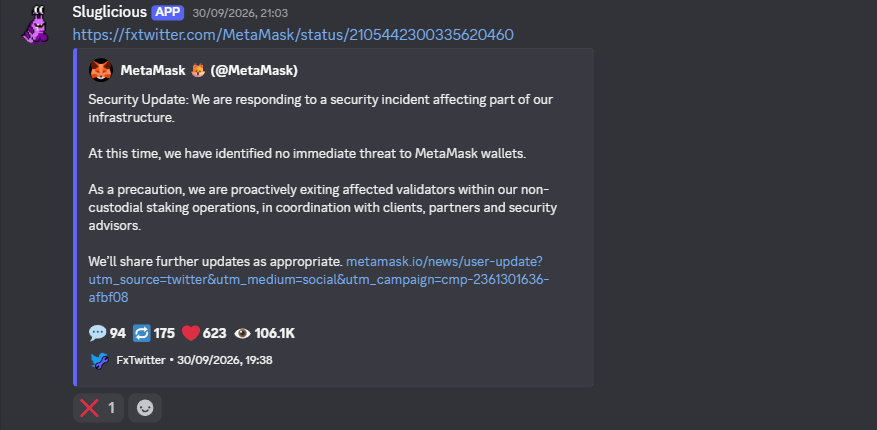
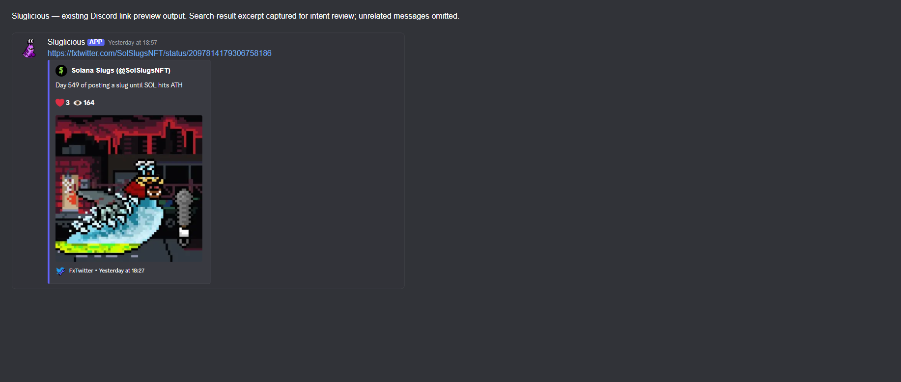
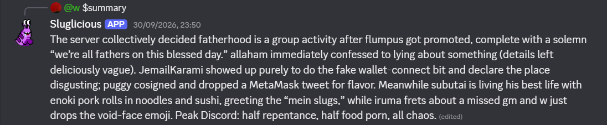

# Sluglicious: Message Content intent examples

These screenshots show existing Sluglicious messages in the Sol Slugs Discord
server. The summary and MetaMask link-preview examples were captured on
15 October 2026 from historical messages. They are not live demonstrations after
Message Content access was removed. No new summary or media-generation commands
were run to produce these captures.

## Channel summary

Sluglicious responds to a `$summary` command with a summary of the channel's
conversation. The screenshot includes the command reference and the bot's reply.

[Original Discord message](https://discord.com/channels/891069801173237800/891081495706480690/1552459727089442966)

## Automatic link preview

An existing user message contains an X link. Sluglicious's following message
provides an FxTwitter preview of that post.

[Original link message](https://discord.com/channels/891069801173237800/891081495706480690/1555022360372056094)
and [bot response](https://discord.com/channels/891069801173237800/891081495706480690/1555022364163444756).
Both messages were posted on 1 October 2026 UTC, displayed as 30 September in the
browser's local time. Discord groups consecutive messages by the same author,
so the cropped input message does not repeat the author's name.

## Another public-post preview

This earlier image was captured on 10 September 2026. It is a rendered DOM
excerpt of real bot output with an explanatory caption and unrelated channel UI
omitted. It shows the output, not the triggering input event.

## Additional summary example

[Original Discord message](https://discord.com/channels/891069801173237800/891081495706480690/1555064295090294826)

## Capture notes

The native Discord screenshots are cropped to individual message elements;
their displayed message content is unchanged. The Discord links document the
sources and may require server membership. The images on this page can be
viewed without joining the server.

These examples do not demonstrate opt-out or deletion behavior.

- [Privacy policy](../../../PRIVACY.md)
- [Channel-summary implementation](https://github.com/zpalmtree/dave/blob/slugs/lib/Summarize.ts)
- [Link-preview implementation](https://github.com/zpalmtree/dave/blob/slugs/lib/ConvertTwitterLinks.ts)
